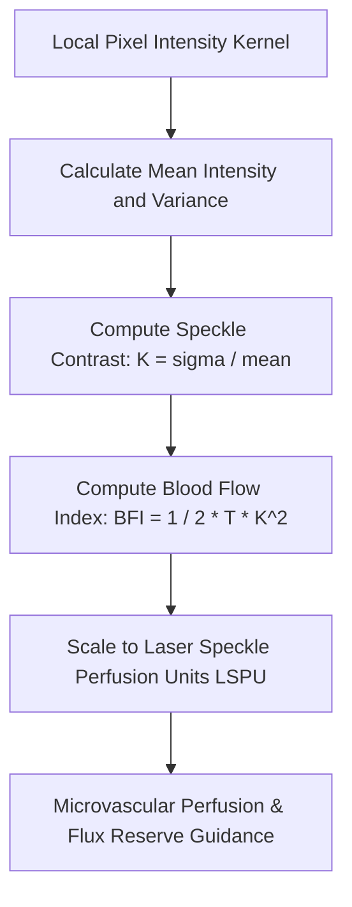

# Cutaneous Laser Speckle Contrast Imaging (LSCI) Skill

[](LICENSE)
[](https://www.python.org/)
[](https://openclaw.org/)
[](https://alphapark.ai/)
[](https://modelcontextprotocol.io/)

Cutaneous Laser Speckle Contrast Imaging (LSCI) and Microvascular Blood Flow Analyzer based on coherent optical scattering physics.



## Features
- **Zero PIP Dependencies**: Implemented strictly with Python Standard Library (`math`, `json`, `sys`, `typing`).
- **Coherent Optics Biophysics**: Translates spatial speckle variance into continuous blood velocity metrics.
- **Exposure-Compensated**: Accounts for camera exposure duration $T$ in the BFI equation.
- **Dual Architecture**: Native Python import and Model Context Protocol (MCP) JSON-RPC 2.0 stdio server.

## Quickstart
```bash
python example_usage.py
```

## License
Apache-2.0
